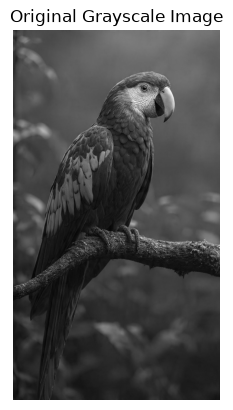
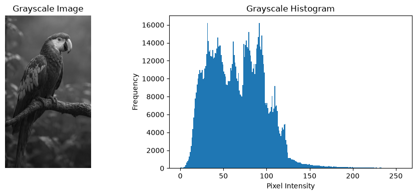
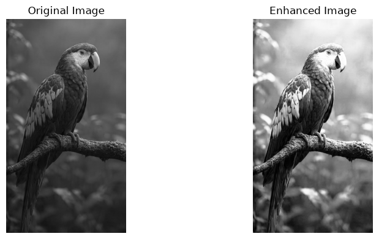
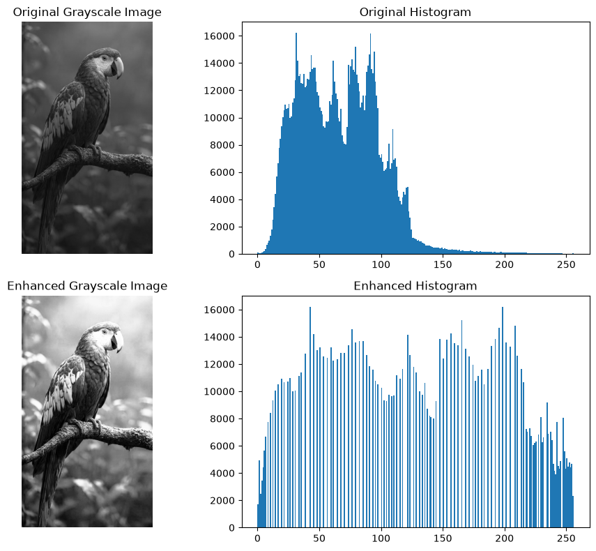
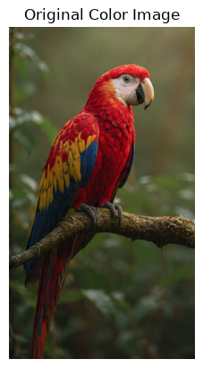
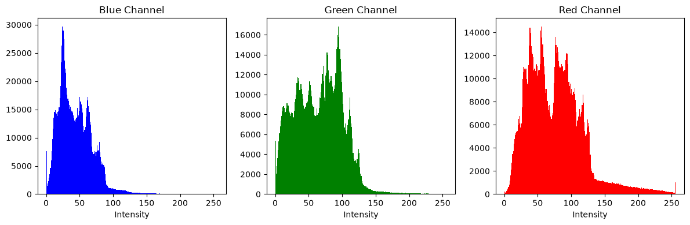
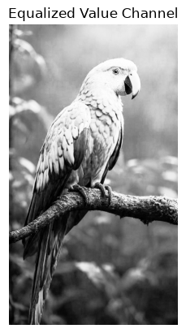
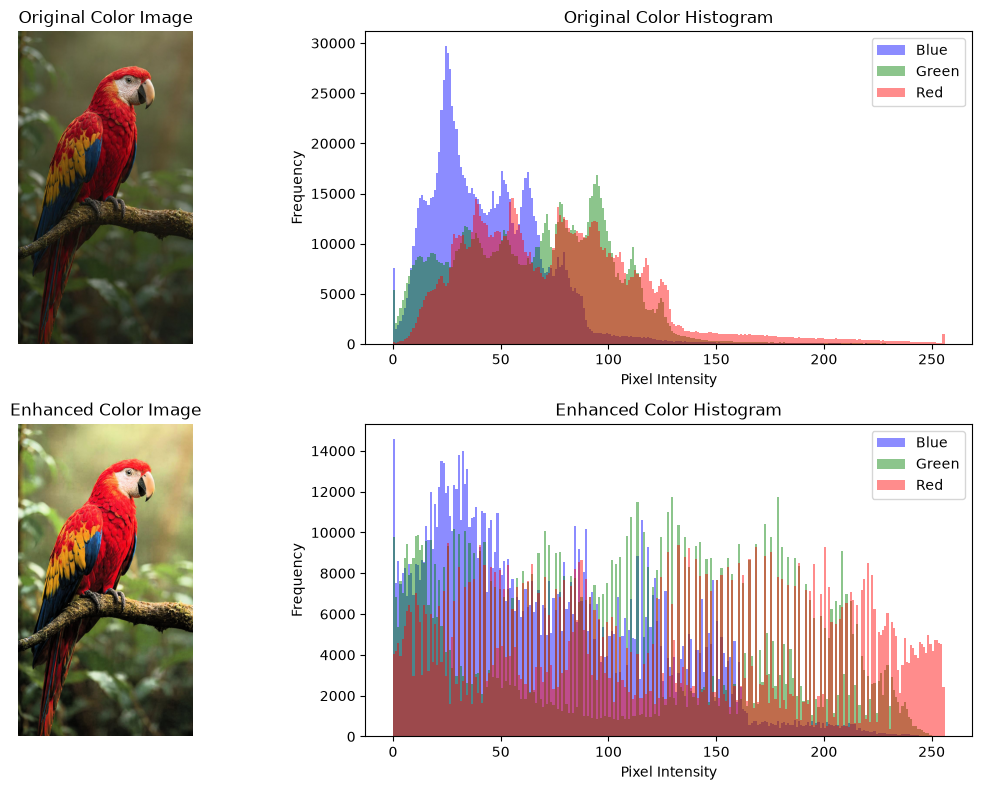

# Image-Handling-and-Pixel-Transformations-Using-OpenCV
AIM:
Write a Python program using OpenCV that performs the following tasks:

1. Read and Display an Image.
2. Adjust the brightness of an image.
3. Modify the image contrast.
4. Generate a third image using bitwise operations.

Software Required:

* Anaconda - Python 3.7
* Jupyter Notebook (for interactive development and execution)

Algorithm:
Step 1:
Import the required libraries (OpenCV, NumPy and Matplotlib).
Step 2:
Read the image (parrot.jpeg.jpg) as a grayscale image and display it.
Step 3:
Plot the histogram of the grayscale image.
Step 4:
Enhance the grayscale image using histogram equalization (cv2.equalizeHist) and compare the original and enhanced images with their histograms.
Step 5:
Read the image as a color image, split it into B, G, R components and plot the histogram of each channel.
Step 6:
Convert the image to HSV, split it into H, S, V components and equalize the Value (V) channel.
Step 7:
Merge the H, S and equalized V channels, convert back to BGR and compare the original and enhanced color images with their histograms.

Program Developed By:

* Name: DEEPAK KUMAR
* Register Number: 212224240029

Ex. No. 01

1. Import the required libraries.

```python
import cv2
import numpy as np
import matplotlib.pyplot as plt

print("Libraries imported successfully!")
```

2. Check the image path.

```python
import os

print("Current folder:", os.getcwd())
print("Image exists:", os.path.exists("parrot.jpeg.jpg"))
```

Output:
```
Current folder: C:\Users\User
Image exists: True
```

3. Read the image as grayscale and display it.

```python
gray = cv2.imread("parrot.jpeg.jpg", cv2.IMREAD_GRAYSCALE)

plt.imshow(gray, cmap="gray")
plt.title("Original Grayscale Image")
plt.axis("off")
plt.show()
```



4. Plot the grayscale image and its histogram.

```python
plt.figure(figsize=(10, 4))

plt.subplot(1, 2, 1)
plt.imshow(gray, cmap="gray")
plt.title("Grayscale Image")
plt.axis("off")

plt.subplot(1, 2, 2)
plt.hist(gray.ravel(), bins=256, range=(0, 256))
plt.title("Grayscale Histogram")
plt.xlabel("Pixel Intensity")
plt.ylabel("Frequency")

plt.tight_layout()
plt.show()
```



5. Enhance the grayscale image using histogram equalization.

```python
equalized = cv2.equalizeHist(gray)

plt.figure(figsize=(10, 4))

plt.subplot(1, 2, 1)
plt.imshow(gray, cmap="gray")
plt.title("Original Image")
plt.axis("off")

plt.subplot(1, 2, 2)
plt.imshow(equalized, cmap="gray")
plt.title("Enhanced Image")
plt.axis("off")

plt.tight_layout()
plt.show()
```



6. Compare the original and enhanced grayscale images with their histograms.

```python
plt.figure(figsize=(10, 8))

plt.subplot(2, 2, 1)
plt.imshow(gray, cmap="gray")
plt.title("Original Grayscale Image")
plt.axis("off")

plt.subplot(2, 2, 2)
plt.hist(gray.ravel(), bins=256, range=(0, 256))
plt.title("Original Histogram")

plt.subplot(2, 2, 3)
plt.imshow(equalized, cmap="gray")
plt.title("Enhanced Grayscale Image")
plt.axis("off")

plt.subplot(2, 2, 4)
plt.hist(equalized.ravel(), bins=256, range=(0, 256))
plt.title("Enhanced Histogram")

plt.tight_layout()
plt.show()
```



7. Read the image as a color image and display it.

```python
color = cv2.imread("parrot.jpeg.jpg")

if color is None:
    raise FileNotFoundError("Check the image filename!")

plt.imshow(cv2.cvtColor(color, cv2.COLOR_BGR2RGB))
plt.title("Original Color Image")
plt.axis("off")
plt.show()
```



8. Split the image into B, G, R channels and plot their histograms.

```python
b, g, r = cv2.split(color)

plt.figure(figsize=(12, 4))

plt.subplot(1, 3, 1)
plt.hist(b.ravel(), bins=256, range=(0, 256), color="blue")
plt.title("Blue Channel")
plt.xlabel("Intensity")

plt.subplot(1, 3, 2)
plt.hist(g.ravel(), bins=256, range=(0, 256), color="green")
plt.title("Green Channel")
plt.xlabel("Intensity")

plt.subplot(1, 3, 3)
plt.hist(r.ravel(), bins=256, range=(0, 256), color="red")
plt.title("Red Channel")
plt.xlabel("Intensity")

plt.tight_layout()
plt.show()
```



9. Convert the image to HSV and split it into H, S, V channels.

```python
hsv = cv2.cvtColor(color, cv2.COLOR_BGR2HSV)

h, s, v = cv2.split(hsv)

print("Converted to HSV successfully!")
```

Output:
```
Converted to HSV successfully!
```

10. Equalize the Value channel.

```python
v_equalized = cv2.equalizeHist(v)

plt.imshow(v_equalized, cmap="gray")
plt.title("Equalized Value Channel")
plt.axis("off")
plt.show()
```



11. Merge the channels and convert back to BGR.

```python
hsv_equalized = cv2.merge((h, s, v_equalized))

enhanced_color = cv2.cvtColor(
    hsv_equalized, cv2.COLOR_HSV2BGR
)

print("Color enhancement completed!")
```

Output:
```
Color enhancement completed!
```

12. Compare the original and enhanced color images with their histograms.

```python
plt.figure(figsize=(12, 8))

# Original color image
plt.subplot(2, 2, 1)
plt.imshow(cv2.cvtColor(color, cv2.COLOR_BGR2RGB))
plt.title("Original Color Image")
plt.axis("off")

# Original histogram
plt.subplot(2, 2, 2)

for channel, col, name in [
    (b, "blue", "Blue"),
    (g, "green", "Green"),
    (r, "red", "Red")
]:
    plt.hist(channel.ravel(), bins=256,
             range=(0, 256), color=col,
             alpha=0.45, label=name)

plt.title("Original Color Histogram")
plt.xlabel("Pixel Intensity")
plt.ylabel("Frequency")
plt.legend()

# Enhanced color image
plt.subplot(2, 2, 3)
plt.imshow(cv2.cvtColor(enhanced_color, cv2.COLOR_BGR2RGB))
plt.title("Enhanced Color Image")
plt.axis("off")

# Enhanced histogram
plt.subplot(2, 2, 4)

eb, eg, er = cv2.split(enhanced_color)

for channel, col, name in [
    (eb, "blue", "Blue"),
    (eg, "green", "Green"),
    (er, "red", "Red")
]:
    plt.hist(channel.ravel(), bins=256,
             range=(0, 256), color=col,
             alpha=0.45, label=name)

plt.title("Enhanced Color Histogram")
plt.xlabel("Pixel Intensity")
plt.ylabel("Frequency")
plt.legend()

plt.tight_layout()
plt.show()
```



Result:
Thus, the image was read and displayed, its histogram was analysed, and the grayscale and color images were enhanced successfully using histogram equalization with OpenCV.
